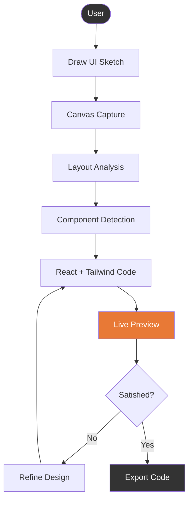
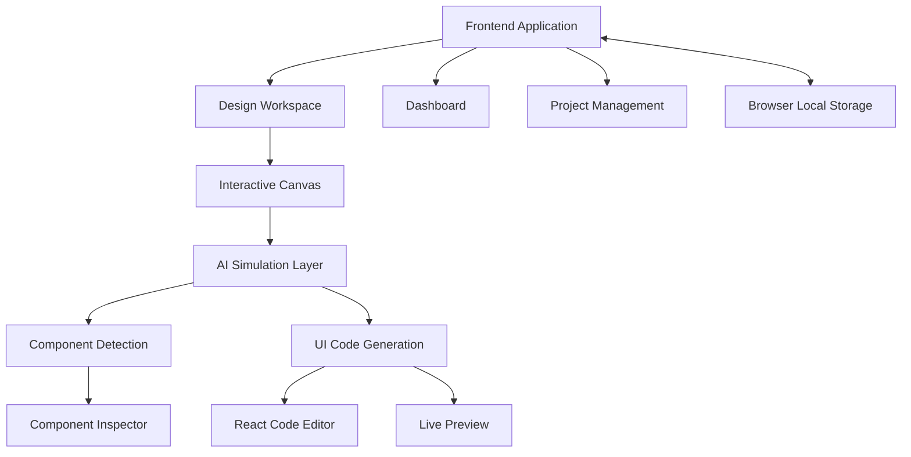
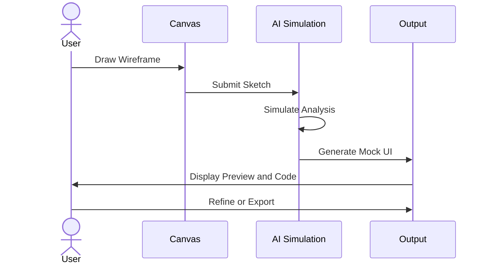

# MorphCanvas AI

### From Rough Sketches to React Interfaces

MorphCanvas AI is a frontend-only prototype of an AI-powered design platform that transforms rough UI sketches into React-style interface concepts.

Users can draw wireframes on an interactive canvas, simulate AI-powered component detection, preview generated interfaces, and explore editable React + Tailwind CSS code.

> **Project Status:** Frontend Prototype — AI analysis and code generation are simulated locally. No backend or actual AI model is connected.

## 1. How It Works

**Sketch → Analyze → Generate → Preview → Refine → Export**



*The analysis and generation steps are simulated in the current prototype.*

## 2. Key Features

| Feature | Description |
|---|---|
| Interactive Canvas | Draw and create UI wireframes |
| AI Design Assistant | Simulated design suggestions |
| Component Detection | Identify predefined UI elements |
| Code Generation | Display React + Tailwind code |
| Live Preview | Visualize generated interfaces |
| Code Editor | Inspect and edit generated code |
| Project Management | Create and manage projects |
| Template Library | Explore predefined UI templates |
| Component Library | Browse reusable components |
| Code Export | Copy or download code |

## 3. System Architecture



## 4. Technology Stack

- **Framework:** Next.js, React
- **Language:** TypeScript
- **Styling:** Tailwind CSS
- **Animations:** Framer Motion
- **Icons:** Lucide React
- **UI Components:** Shadcn UI
- **Storage:** Browser Local Storage

*Canvas and code-editor libraries depend on the actual repository implementation.*

## 5. Application Pages

| Route | Description |
|---|---|
| `/` | SaaS Landing Page |
| `/login` | Login |
| `/signup` | Registration |
| `/dashboard` | Project Dashboard |
| `/workspace/new` | Design Workspace |
| `/projects` | Project Management |
| `/templates` | Template Library |
| `/components` | Component Library |
| `/activity` | Recent Activities |
| `/settings` | User Preferences |

## 6. Project Workflow



## 7. Run Locally

**Prerequisites:** Node.js and npm.

```bash
git clone <repository-url>
cd morphcanvas-ai
npm install
npm run dev
```

Open `http://localhost:3000`.

For production build:

```bash
npm run build
```

## 8. Future Scope

- Real Vision-Language Model integration.
- Actual sketch-to-code generation.
- Backend authentication and database.
- Secure code execution environment.
- Responsive UI generation.
- Cloud project storage and collaboration.

## 9. Conclusion

MorphCanvas AI demonstrates how visual sketches can be connected with frontend development through an AI-assisted design workflow. The current prototype establishes the user experience, interactive workspace, and code-preview concept, providing a foundation for future AI and backend integration.

---

**MorphCanvas AI | Sketch. Generate. Build.**
